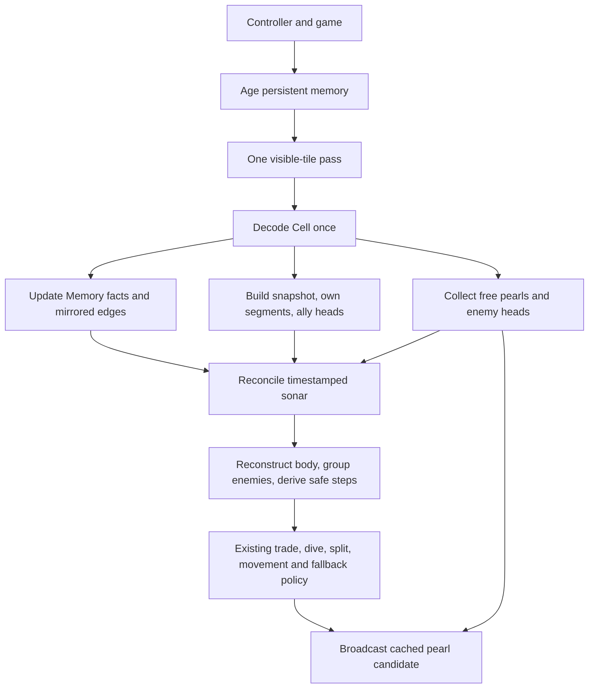

# V06 — Unified Perception

Implemented against `CODEX_HANDOFF_UNSW_BATTLECODE_V2.md` on 2026-09-23.
The working directory remains `Version05_sketch`; its code now implements **V06**.
V05 instrumentation is retained. This phase changes sensing architecture while preserving policy.

## Source audit and implementation plan

| Area | Audited V05 behavior | V06 disposition |
|---|---|---|
| Instrumentation | `DebugTurn` surrounds `act` and exception recovery; 29 optional counters; default build has no telemetry | Keep all hooks; add `perception_tiles_scanned` |
| Orchestration | Configure → memory.observe → receive_sonar → look → short_trade → dive → voluntary split → emergency split → choose/broadcast/consume → fallback | Replace only sensing and broadcast inputs; retain action priority and early returns |
| Raw sensing | Memory and look each scan all visible tiles; normal movement/split broadcasting adds a third scan | One raw-tile pass on the unified path |
| Memory | ETA delta aging; direct pearl TTL 32; sonar TTL 8; timestamps; mirrored edges; visible emptiness overrides reports | Extract `begin_turn` and `observe_cell`; preserve all reconciliation rules |
| Pocket | Flood fill and degree analysis repeated per safe first step | Unchanged; component caching belongs to V07 |
| Enemy work | Snapshot grouping, candidate-by-enemy tactical scoring, repeated escape checks | Preserve grouping order and computations; threat caching belongs to V07 |
| Exploration | Known EMPTY edges adjoining unseen cells form frontier; bounded BFS routes to resources/frontier | Unchanged; deliberate expansion belongs to V08 |
| Persistent state | Per-process `Memory`: seen, edges, pearls, ETA, direct timestamps, shared reports, last round | No persistent navigation or role state added |
| Flags | Routing, sonar, head risk, corner pressure, short trade; compile/runtime diagnostics | Add independent unified-perception flag, enabled by default |
| Harness | Strict compile; behavior and instrumentation tests; parser tests; swapped-side action-trace benchmark | Extend existing harness for V06 and optional frozen-baseline profiling |

Planned and implemented files: new `observation.hpp`, `perception.hpp`, `tests/perception.cpp`; edits to `memory.hpp`, `sense.hpp`, `sonar.hpp`, `decide.hpp`, `strategy.hpp`, `debug.hpp`, test runner/parser tests, and the existing benchmark tool. `main.cpp`, helper/protocol code, forage, navigation, tactics, kamikaze, opening/splitting, and model constants are unchanged.

The invariant is one raw visible-tile visit per successful unified sensing turn. Memory timestamps, derived views, tactical tie order, command output, and sonar destination must remain identical. Validation compares those values directly and runs full matches against an independent frozen V05 source snapshot.

## Workflow



The final broadcast is called only on the same movement/split branches as V05. Short-trade, dive, and fallback retain their original early returns.

## Interfaces and semantics

- `observation.hpp::read_cell(tile, my_id, my_team)` extracts pearl state, spawn ETA, four edges, and segment identity/facing into the existing `Cell` type. Moving `Cell` out of `sense.hpp` allows Memory and View to share that representation.
- `Memory::begin_turn(game, config)` configures dimensions and ages old facts once. `observe_cell(position, cell)` then applies a direct observation using the current `last_round`. Standalone `Memory::observe` remains a compatibility wrapper.
- `ViewBuilder::add` accumulates the snapshot, own-segment index, and ally heads. `finish` reconstructs the body, groups enemies, and computes the existing safe steps. Snapshot insertion and enemy traversal order remain unchanged to avoid altering ties.
- `sense_nearby(ct, game, memory, config)` returns `Perception{view, visible_pearls, visible_enemy_heads, round}`. It ages memory, scans raw tiles once, reconciles sonar after all direct observations, and finalizes the View.
- `visible_pearls` means **directly visible, unoccupied broadcast candidates**. Occupied pearls still appear in `View::snap` and Memory. The broadcast overload filters the selected movement destination afterward, retaining the V05 toroidal-distance / x / y tie-break and never relaying reports.
- Enemy heads are available for later consumers; they do not change current tactics.

`strategy.unified_perception` defaults to true. Set `StrategyConfig::unified_perception = false` in a test or compile with `-DXXQZ_UNIFIED_PERCEPTION=0` to use the legacy orchestration. The compatibility path shares extracted helpers; the independent frozen V05 remains the authoritative behavior baseline.

Statistics still use `LOG V05_STATS` for compatibility with the V05 parser; this marker identifies the telemetry format, not the current bot version. The schema now has 30 counters:

```text
tiles_scanned = perception_tiles_scanned
              + memory_tiles_scanned
              + sense_tiles_scanned
              + broadcast_tiles_scanned
```

On the unified path the three legacy phase counters are zero. Grouping enemies and computing pockets still traverse the derived snapshot; these are deliberately outside the raw-tile metric.

## Validation commands

From this bot directory:

```sh
python3 tests/run.py
python3 tests/run.py --sanitize
clang++ -std=c++20 -O2 -Wall -Wextra -Wpedantic -Werror main.cpp -o /tmp/xxqz-v06
python3 tools/benchmark_v05.py --phase V06 --profile-baseline \
  --baseline ../Version05_frozen \
  --maps ../maps/arena.map ../maps/default.map ../maps/big_empty.map ../maps/schooltime.map \
  --output ../replays/V06-local-comparison
```

The output directory must be new. Keep benchmark source snapshots outside the bot directory: the toolkit matches source basenames recursively.

Tests cover the existing 49 gameplay checks in both diagnostic builds; 6/19 V05 instrumentation checks; 6,819/9,519 new perception assertions with diagnostics off/on; and 11 Python harness tests. The perception suite exercises direct-vs-sonar freshness, empty observations, independent TTLs, curved/incomplete bodies, occupied/consumed pearls, deterministic broadcast ties, trade/dive/normal movement/both split paths/fallback, sonar disabled, and 100 seeded generated views with wraparound and mixed edges. All are run with strict warnings, and again with AddressSanitizer/UndefinedBehaviorSanitizer. The toolkit's `bot.toml` project build also verifies only `main.cpp` is compiled and both new headers are included.

## Measured results

All 28 runs passed: four frozen-V05 self-play references, eight V06 release comparisons, eight V06 profile comparisons, and eight frozen-V05 profile controls. Every non-reference run exactly matches its reference's complete command trace and outcome, with candidate sides swapped on all four maps.

The per-turn audit compares **80,228** V06 profile turns with their frozen-V05 counterparts. Raw tile visits fall from **11,740,204 to 3,931,172**, or **146.335 to 49 per turn (66.515% fewer)**. Every unified turn satisfies the single-pass invariant, and all **25 non-sensing counters** are identical turn by turn.

| Counter | V05 mean/turn | V06 mean/turn | V06 p95 |
|---|---:|---:|---:|
| tiles_scanned | 146.335 | 49.0 | 49 |
| pocket_calls | 2.26 | 2.26 | 3 |
| pocket_nodes | 56.895 | 56.895 | 129 |
| route_nodes | 168.97 | 168.97 | 320 |
| frontier_cells_checked | 269.984 | 269.984 | 719 |
| fallback_calls | 0.011 | 0.011 | 0 |
| exceptions | 0.0 | 0.0 | 0 |
| emergency_defaults | 0.0 | 0.0 | 0 |

No runner failures, caught exceptions, or emergency defaults were recorded. The 896 fallback calls are identical existing policy behavior, not exceptions.

| Map | All variants' result |
|---|---|
| arena | B wins, round 129, elimination |
| default | B wins, round 500, length |
| big_empty | A wins, round 500, length |
| schooltime | B wins, round 500, length |

V06 release scores 4 wins / 4 losses against V05 across the swapped sides, with exact reference trace parity. This is evidence of preserved behavior, not a win-rate improvement claim.

Replay review used the full action and annotation streams, branch counts, and recorded examples for resource routing, exploration, splitting, short trades, dive attacks, and fallback. No graphical replay-viewer review was performed. `per-turn-audit.json` contains those examples; 28 binary replays and 28 compressed verbose logs are archived alongside source/map snapshots and hashes. `audit_v06.py` in that archive reproduces the counter and trace audit.

The measured gain is fewer raw-tile loops and extractions, plus removal of the broadcast candidate hash set. The helper already caches vision. These counters do not measure engine sensing calls or prove a specific CPU/contest-points improvement; native wall times are only supplementary. Derived topology and tactical work remain for V07.


## Versions and follow-on scope

- Working V06: `/Users/fanlingjun/Desktop/UNSW_battlecode/Version05_sketch`
- Frozen pre-upgrade V05: `/Users/fanlingjun/Desktop/UNSW_battlecode/Version05_frozen`
- Earlier V04: `/Users/fanlingjun/Desktop/UNSW_battlecode/Version04` (unchanged)
- Full benchmark archive: `/Users/fanlingjun/Desktop/UNSW_battlecode/replays/V06-unified-perception-20260923`

V07 component/threat caching, V08 expansion/navigation memory, V09 candidate-state scoring, and V10 roles are later phases. No BugNav or symmetry was introduced. `V05.md` and older validation JSON files are historical records; current results are in `tests/v06-validation.json`.
