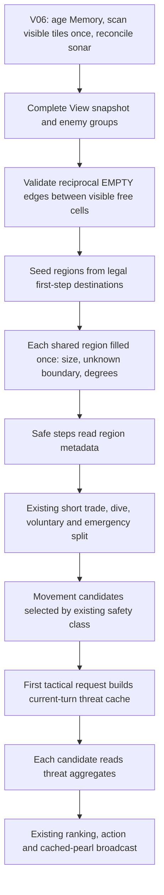

# V07 — Derived Perception Cache

Current working version: **Version07_sketch**. Based on the validated V06 source previously stored in `Version05_sketch`, following `CODEX_HANDOFF_UNSW_BATTLECODE_V2.md`.

## What changes

V07 reuses local topology and enemy analysis from the current turn. It keeps V06's one raw visible-tile pass, Memory reconciliation, sonar precedence, route budget, scoring weights, attack/split ordering, and fallback policy.

| File | Responsibility |
|---|---|
| `view.hpp` | Existing View/StepInfo/Enemy types plus topology and threat cache data |
| `topology.hpp` | Validate free-cell edge reciprocity; compute candidate-reachable connected regions once |
| `threats.hpp` | Enemy escapes, reachable/forward masks, and per-direction threat aggregates |
| `sense.hpp` | Build topology after the current snapshot is complete; use region lookup for safe steps |
| `tactics.hpp` | Build threat facts at first tactical use, then score candidates from aggregates |
| `strategy.hpp` | Independent component/threat cache switches |
| `debug.hpp` | Preserve existing telemetry; add cache work counters |
| `perception.hpp`, `decide.hpp` | Propagate config through both sensing paths |
| `tests/derived.cpp` | Cached/uncached semantic, scenario, ablation, and work-count checks |

## Workflow



Earlier-return branches retain their existing behavior. They do not build unused threat data.

## Topology semantics

`TopologyCache` stores `component_id[position]` and `regions`. `RegionInfo` stores size, whether an EMPTY edge reaches an unknown tile, and minimum/maximum internal degree. Degree is computed during the component traversal, removing the old second degree pass.

Only regions reachable from executable first-step destinations are seeded. A shared region is filled once even when several first steps enter it. Disconnected regions that cannot affect the current moves are not precomputed; `pocket()` retains the original calculation for an uncached position. This makes the cache useful to current movement without paying for irrelevant disconnected pockets.

Occupancy and boundaries retain V06 semantics:

- Only `Owner::Empty` cells belong to free-space regions; the dragon's body remains occupied.
- Only EMPTY edges connect regions. Kelp and portals do not connect them.
- An EMPTY edge to an unseen tile marks `touches_unknown`.
- Closed regions are hard traps when they are a chain with an endpoint, or smaller than the dragon's length.
- An open region with maximum internal degree at most two remains a soft trap.
- Toroidal wrapping and duplicate-neighbor direction counts are preserved.

Undirected components require reciprocal EMPTY edges between visible free cells. The validation pass detects asymmetric custom/test snapshots and retains the original directed flood fill for that View. It does not silently reinterpret a one-way edge. The cache contains only derived snapshot data and does not change Memory.

## Threat semantics

`EnemyThreat` records enemy ID, head, visible length, escape count, and four-bit reach/facing masks. Masks refer to current safe first-step directions. `ThreatBucket` groups reachable and forward-facing enemy counts by escape count (0–4), so candidate scoring no longer repeats a scan of all enemies.

`View::threats` is memoized on the first tactical request. It is reused within that View and begins empty on every new turn. Configuration and controller-dependent scoring remain outside the cache: changing dragon length, unit count, map-area thresholds, risk flags, or weights still applies the original scoring rules to the same facts. Unsupported destinations use `tactical_score_uncached`.

Portals count as possible enemy escapes, as in V06. They do not count as an ordinary adjacent attack route. Headless visible enemy groups remain excluded from head-threat scoring. For tiny toroidal maps, facing masks preserve the original last-direction-wins behavior when two directions reach the same tile.

Views are immutable snapshots once their caches are used. Test/custom code that changes snapshot cells, enemy groups, or safe candidates must rebuild/clear the affected caches. Production constructs a fresh View each turn.

## Feature flags and instrumentation

Both `StrategyConfig::component_cache` and `StrategyConfig::threat_cache` default to true. Runtime flags can disable either independently. Compile-time defaults can be overridden with:

```sh
-DXXQZ_COMPONENT_CACHE=0 -DXXQZ_THREAT_CACHE=0
```

The V06 unified-perception switch remains independent. Both raw sensing paths pass the same config into View construction. The default build still disables diagnostic output.

The `LOG V05_STATS` telemetry format is retained for parser compatibility. The schema now has 40 fields. New counters:

| Counter | Meaning |
|---|---|
| `component_builds` | Current-turn topology preparation attempts |
| `component_validation_tiles` | Snapshot entries checked for free-edge reciprocity |
| `component_regions` | Candidate-reachable regions flood-filled |
| `component_nodes` | Free cells visited across those regions |
| `component_lookups` | Pocket requests served by cached region data |
| `component_fallbacks` | Views with asymmetric free edges requiring legacy flood fills |
| `threat_builds` | On-demand threat preprocessing calls |
| `threat_enemy_checks` | Enemy-group visits during preprocessing |
| `threat_edges` | Enemy outgoing directions examined for reach/facing |
| `threat_lookups` | Tactical requests served by a direction aggregate |

Legacy `pocket_*` counters now count only legacy work. For an honest comparison, include `component_regions/nodes` when reporting new flood-fill work. Similarly compare old `tactical_enemy_checks` with new `threat_enemy_checks + tactical_enemy_checks`. `escape_calls/edges` count actual escape work in either path. The reciprocity check is extra snapshot work, not a raw engine-vision scan; these counters alone do not prove CPU savings.

## Validation

```sh
python3 tests/run.py
python3 tests/run.py --sanitize
python3 tools/benchmark_v05.py --phase V07 --profile-baseline \
  --baseline ../Version06_frozen \
  --maps ../maps/arena.map ../maps/default.map ../maps/big_empty.map ../maps/schooltime.map \
  --output ../replays/V07-local-comparison
```

Use a new output directory outside the bot source tree. The toolkit matches source basenames recursively.

V05/V06 tests remain: 49 behavior checks in each diagnostics build, 6/19 legacy instrumentation checks, 6,819/10,599 unified-perception assertions, and 11 benchmark parser tests. V07 adds 23,284/23,286 derived-cache assertions with diagnostics off/on. Tests compare region and trap results at multiple lengths, safe-step ordering, tactical scores across flags/lengths/unit counts, and complete command/Memory parity for all cache combinations under both sensing paths. Dedicated scenarios cover a shared open region, closed chain, open corridor, portal, asymmetric edges, stale-cache clearing, simultaneous enemy threats, and tiny-torus duplicate neighbors. Eighty seeded generated reciprocal snapshots exercise wrapping, blockers, occupants, pearls, and all cache ablations.

Strict warning builds, AddressSanitizer/UndefinedBehaviorSanitizer, and the toolkit project build all passed. The project includes all three new headers and compiles only `main.cpp`.

All **28 final benchmark runs** passed: four V06 self-play references, eight V07 release comparisons, eight V07 profile comparisons, and eight V06 profile controls. Candidate sides are swapped on all four maps. Every non-reference run matches the complete reference command stream and result exactly.

The paired audit covers **80,228 dragon turns**. All 24 counters outside the replaced topology/tactical work are identical turn by turn. Each V07 turn retains 49 raw visible-tile visits, every safe-step pocket query uses a cached region, and no directed-edge fallback is needed on these engine maps. On every individual turn, region fill/node counts and enemy-analysis visits are no greater than their corresponding V06 repeated-work counts.

| Work metric | V06 total | V07 total, including cache work | Reduction |
|---|---:|---:|---:|
| flood_fills | 181,287 | 93,651 | 48.341% |
| flood_nodes | 4,564,558 | 1,962,148 | 57.013% |
| enemy_analysis | 103,572 | 50,160 | 51.57% |
| escape_calls | 3,149 | 3,064 | 2.699% |

The old separate pocket degree pass (4,564,558 cell visits) is also removed; degree calculation occurs during the component traversal. The new edge-reciprocity validation checks 3,931,172 snapshot entries (49 per turn). That is additional derived-snapshot validation, so the percentages above are specific work counters, not measured total CPU speedups or contest-point savings.

Escape calculations are modestly lower overall, but not on every map: arena rises from 198 to 208, schooltime from 945 to 960; default falls from 741 to 697 and big_empty from 1,265 to 1,199. On 209 individual turns V07 performs more escape calculations because threat preprocessing covers all safe candidates before the existing ranking restricts them to a safety class. Each reachable enemy is still analyzed at most once by the cache. The aggregate tradeoff is recorded rather than hidden.

| Map | Result in all variants |
|---|---|
| arena | B wins, round 129, elimination |
| default | B wins, round 500, length |
| big_empty | A wins, round 500, length |
| schooltime | B wins, round 500, length |

No runner failures, caught exceptions, or emergency-default actions were recorded. Existing fallback decisions remain identical. V07 release scores 4 wins and 4 losses against V06 with swapped sides, as expected from identical traces; this phase makes no win-rate improvement claim.

Replay review compared full action and annotation streams and inspected recorded examples of short trades, dive attacks, splitting, resource routing, exploration, and fallback. No graphical replay-viewer review was performed. The archive includes 28 replay files, 28 compressed verbose logs, source/map snapshots and hashes, `summary.json`, and `per-turn-audit.json`. Reproduce the detailed audit with:

```sh
python3 tools/audit_v07.py ../replays/V07-derived-perception-20260923
```

Validation used the local native runner. Contest CPU/points budgets remain unmeasured.


## Version locations and next phase

- Active V07: `/Users/fanlingjun/Desktop/UNSW_battlecode/Version07_sketch`
- Frozen V06: `/Users/fanlingjun/Desktop/UNSW_battlecode/Version06_frozen`
- Previous V06 working directory: `/Users/fanlingjun/Desktop/UNSW_battlecode/Version05_sketch` (unchanged; use Version07_sketch for further work)
- Evidence: `/Users/fanlingjun/Desktop/UNSW_battlecode/replays/V07-derived-perception-20260923`

V04 and frozen V05 remain unchanged. Older Markdown and validation JSON files are historical records. V07 results are recorded in `tests/v07-validation.json`.

The next roadmap phase is V08: deliberate early expansion plus persistent navigation progress and recovery. V07 adds no BugNav, expansion policy, navigation memory, candidate-state scoring engine, roles, or symmetry system.
