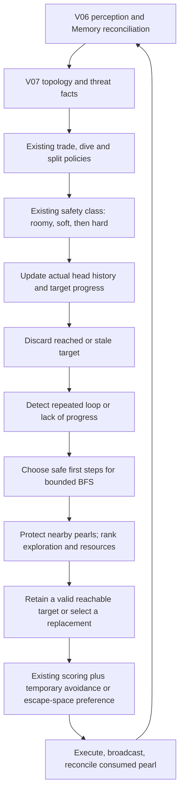

# V08 — Stateful Expansion and Navigation

Active directory: `Version08_sketch`. Built from the frozen V07 baseline according to `CODEX_HANDOFF_UNSW_BATTLECODE_V2.md`.

V08 is a strategy change. It adds deliberate early exploration and navigation persistence/recovery while retaining V07 perception, connected-region/threat caches, Memory and sonar rules, combat priority, split conditions, and the existing movement safety classes. No BugNav, symmetry inference, V09 candidate-state engine, or V10 role system is included.

## Implementation

| File | Change |
|---|---|
| `nav_state.hpp` | NavigationState, modes, purposes, and shared RouteKind |
| `memory.hpp` | Own a dragon's NavigationState alongside its persistent map facts |
| `navigation_v08.hpp` | Progress/history tracking, exploration valuation, bounded planning, retention, retargeting and local recovery |
| `navigation.hpp` | Keep V07 router for ablation; RouteKind moves to the shared state header |
| `forage.hpp` | Select V08 routing when enabled; add recovery adjustments within the existing safety class |
| `decide.hpp` | Clear navigation intent when combat, splitting, or fallback interrupts ordinary movement |
| `strategy.hpp` | Six independent feature switches and bounded recovery parameters |
| `debug.hpp` | Navigation event/work counters |
| `tests/navigation_state.cpp` | Stateful sequence, safety, economy, feature and budget checks |
| `tools/observed_run.py` | Read-only runner observation adapter for comparable V07/V08 metrics |
| `tools/benchmark_v08.py` | Frozen-baseline comparisons, disabled-feature parity, diagnostic-build parity and replay evidence |

## Workflow



Navigation state belongs to `Memory`, which is per dragon process. Identity and backwards-round checks reset it if reused for another dragon/game. Gaps between navigation turns reset movement intent/history, preventing splits or multi-step attacks from being misread as ordinary progress. Resetting Memory in tests also resets navigation state.

## Early expansion

One third of IDs (`id % 3 == 0`) may promote exploration during the first 80 engine rounds, while all dragons can use sector preferences when selecting exploration goals. This is a bounded opening policy, not a persistent role assignment.

Exploration gets promoted above distant resources only when all these conditions hold:

- Map area is at least 400 cells.
- There are teammates and the dragon length is at most eight.
- No enemy head is currently visible.
- This dragon has observed less than 60% of the map.
- No reachable visible pearl is within three BFS steps.

This protects immediate collection and avoids sacrificing resources for redundant exploration on compact maps. The coverage gate uses the dragon's actual local Memory; it does not assume access to shared team coverage.

The sector is `(id ^ (id >> 1)) & 3`, mapped to N/E/S/W. Folding the high bit lets teams with exclusively even or odd IDs use all four directions. There is no assumed map symmetry or fixed enemy location.

Reachable frontier goals are ranked by:

```text
6 × unseen samples in the prospective observation footprint
+ early-sector alignment
− lateral displacement
− overlap with currently visible allied heads
− 12 × BFS distance
```

Information gain uses nine spaced samples of the next 7×7 footprint, keeping the calculation bounded. Sector alignment uses signed toroidal displacement. Ally overlap is a local estimate, not global team coordination. During expansion, exploration ranks ahead of distant pearls/spawn locations; outside that policy, V07's resource tiers remain ahead of exploration.

## Persistent navigation and recovery

State records target/kind/purpose/mode, best toroidal distance, stagnant turns, failed searches, six recent heads, temporary avoidance, rejected-target cooldown and a short escape deadline.

- **Progress:** A closer actual head position resets stagnation. Equal/worse distance increments it. History updates at most once per round.
- **Stale goals:** Reached targets, newly observed exploration targets, visibly empty pearl targets, expired direct/sonar reports and invalid spawn timers are dropped.
- **Retention:** A retained target must still be valid and reachable in the current bounded search. Higher-priority resources supersede it. Resource retention permits at most one extra BFS step; exploration permits four. A nearer immediate pearl always wins.
- **Loops:** Detect A–B–A–B and A–B–C–D–A–B. For a four-step cycle, avoid the next cell from the previous lap, not the dragon's occupied neck.
- **Temporary avoidance:** After a loop or six stagnant turns, avoid a repeated first step for two rounds when a same-safety-class alternative has no worse current tactical score. Immediate pearls are exempt. If avoidance would remove the only usable option, retain it.
- **Retargeting:** After ten stagnant turns or three failed searches for an existing goal, reject that goal for eight rounds and choose another. The bounded search never increases its budget for recovery.
- **Escape:** Retargeting can trigger three rounds of local recovery; hard-trap candidates also trigger escape scoring. Within the existing safety class, prefer more region space, more EMPTY-edge exits and less known head danger. Progress toward the replacement goal ends recovery early; otherwise the short deadline ends it.

`NavMode` distinguishes Expand, Route, Retarget and Escape; Retarget is a transition, not a new pathfinding algorithm. The planner performs one BFS per movement decision, with the existing default depth 24 and at most 320 discovered nodes. It uses the current body/occupancy, known edges, and V07-safe first steps. Unknown cells remain planning hypotheses; normal navigation does not cross portals.

## Feature flags

Each defaults on and has a compile-time default override:

| Runtime StrategyConfig flag | Compile-time macro |
|---|---|
| `expansion` | `XXQZ_EXPANSION` |
| `sector_exploration` | `XXQZ_SECTOR_EXPLORATION` |
| `nav_memory` | `XXQZ_NAV_MEMORY` |
| `anti_oscillation` | `XXQZ_ANTI_OSCILLATION` |
| `retargeting` | `XXQZ_RETARGETING` |
| `escape_mode` | `XXQZ_ESCAPE_MODE` |

`-DXXQZ_V08=0` defaults all six off and restores V07 policy. Explicit individual macros override that group default. Setting `routing=false` also bypasses the V08 routing layer. Disabling `nav_memory` uses transient per-decision state, so multi-turn recovery intentionally cannot accumulate; expansion can still operate independently.

## Instrumentation and validation

The existing `LOG V05_STATS` format is retained; its name denotes telemetry compatibility, not bot version. Eleven new counters record non-improving navigation turns, detected loops, retargets, stale goals, retained targets, avoided-step turns, escape turns/recoveries, promoted expansion turns, route failures, and information samples.

`nav_stagnant_turns` counts turns with no improvement, not just turns beyond the recovery threshold. `nav_expand_turns` counts promoted exploration decisions. These event counters are not themselves proof of improved strategy.

Run from Version08_sketch:

```sh
python3 tests/run.py
python3 tests/run.py --sanitize
python3 tools/benchmark_v08.py --baseline ../Version07_frozen \
  --maps ../maps/arena.map ../maps/default.map ../maps/big_empty.map ../maps/schooltime.map \
  --output ../replays/V08-local-comparison
```

Use a new benchmark output directory outside the bot tree. To study individual switches, pass e.g. `--extra-flag=-DXXQZ_EXPANSION=0 --pilot`.

The harness runs four V07 reference matches, eight V08 matches with sides swapped, eight V08-disabled comparisons, and eight V08 diagnostic-build comparisons. Disabled-feature matches must reproduce V07's entire command trace and outcome. Diagnostic builds must reproduce the corresponding V08 normal build. Strategy differences from V07 are expected and recorded as first differing action/annotation examples.

The observation adapter wraps the installed engine's callbacks without changing engine input or bot replies. Both versions get the same measurement method. It records cumulative team observed-cell coverage (including observations of dragons later lost), per-round vision overlap, nearest-ally separation, latest observed living-team length, and observed two-/four-step loops. Lengths and positions are each dragon's latest pre-action observation, not a simultaneous end-round snapshot. These are economy/spacing proxies, not a direct pearl-harvest count. Tests verify decoding, wrapping, overlap arithmetic, coverage monotonicity and loop/gap handling.

## Final results (2026-09-23)

All technical checks pass:

- Strict optimized builds and AddressSanitizer/UndefinedBehaviorSanitizer runs.
- Existing 49 gameplay checks in each diagnostics build; 6/19 historical instrumentation checks; 6,819/11,787 perception assertions; 23,284/23,286 derived-cache assertions.
- 41/42 new V08 sequence checks (diagnostics off/on), including four-sector coverage for even IDs, immediate-pearl priority, compact/contested-map expansion gates, retention, stale reports, two-/four-step loops, avoidance risk guard, retarget cooldown, escape progress, identity resets, portals, safety-class first steps and search limits.
- Eleven existing benchmark parser tests and five new observer tests.
- Toolkit `bot.toml` build includes the new navigation headers and compiles only `main.cpp`.
- All 28 final match runs pass technical validation: **8/8 disabled-feature parity checks** and **8/8 diagnostic-build parity checks**, plus four references and eight normal V08 matches.
- Across **87,697 V08 diagnostic dragon turns**, raw sensing stays at 49 tiles; route calls are at most one per turn and discovered route nodes at most 320. No runner failures, caught exceptions, or emergency defaults were observed.

Normal-build V08 versus V07 results:

| Map | V08 as A | V08 as B |
|---|---|---|
| arena | Loss, round 268, elimination | Loss, round 130, elimination |
| default | Win, round 500, length | Loss, round 500, length |
| big_empty | Win, round 500, length | Win, round 500, length |
| schooltime | Win, round 500, length | Win, round 500, length |

**5 wins / 3 losses** is a small deterministic regression sample, not a reliable win-rate estimate. The compact arena regresses; V08 should remain a separately reviewable sketch with V07 available for comparison.

The table below averages the same-side comparison across four maps and both side assignments (eight pairs). Engine rounds are zero-based. Each cell is V07 → V08. Coverage and overlap use fractions of map/observations; spacing is toroidal tiles, and length is the latest-observation proxy described above.

| Engine round | Team map coverage | Vision overlap (lower is better) | Nearest-ally distance | Observed team length |
|---:|---:|---:|---:|---:|
| 10 | 34.94% → 36.60% | 24.74% → 19.80% | 4.55 → 5.17 | 13.75 → 13.88 |
| 25 | 46.88% → 51.39% | 41.53% → 37.80% | 4.41 → 4.74 | 23.12 → 24.00 |
| 50 | 60.06% → 64.56% | 34.69% → 37.22% | 5.36 → 4.79 | 37.25 → 41.38 |
| 80 | 73.65% → 80.40% | 34.62% → 32.88% | 5.24 → 5.76 | 61.62 → 66.88 |
| 100 | 79.51% → 86.20% | 37.65% → 35.92% | 5.51 → 5.47 | 81.50 → 89.00 |

At round 50, coverage rises **4.50 percentage points**, and mean observed team length rises from 37.25 to 41.375 (**11.1%**). At round 25, overlap falls from 41.53% to 37.80% and nearest-ally distance rises from 4.41 to 4.74 tiles. At round 50, however, overlap worsens and spacing contracts; improvements are not uniform over time or across maps. The test set does not show a large aggregate early economy loss, but the length proxy is not a direct pearl-harvest measurement.

Observed two-/four-step loop turns fall from **1,249 to 942** despite more V08 turns. Normalized rates are **15.5681 → 10.7415 per 1,000 dragon turns**, a **31.0% reduction**. This measurement comes from the runner observations for both versions, independently of the new navigation counters.

V08 telemetry records 116 retargets, 18,842 reached/stale-target drops, 43,855 retained-target decisions, 1,986 temporary-avoidance turns, 1,170 promoted expansion decisions, and 99 exits from a timed recovery window after distance progress. The 3,505 escape-eligible turns include hard-trap cases; preserved combat-stalking priority can override navigation adjustments. These event counts demonstrate that recovery paths execute, but do not establish a controlled improvement in trapped-dragon recovery rate. Dedicated sequence tests verify recovery and larger-space preference.

Replay review uses full command/annotation streams, first-difference examples, observation timelines, and recorded recovery examples in `navigation-audit.json`. No graphical replay viewer review was performed. Both feature-disabled and diagnostic parity compare the full protocol, not only game outcomes.

## Remaining limitations

- Compact-map results regress and need further tactical evaluation; expansion gating alone does not eliminate changes from navigation persistence/recovery.
- Geometric progress can temporarily worsen on a correct detour. Thresholds and short avoidance/cooldown windows bound recovery, but do not prove optimal navigation.
- Exploration overlap avoidance uses only visible allied heads. There is no shared sector reservation or global coverage communication.
- Four fixed maps with one run per side are insufficient to claim general competitive improvement. Opponent responses change with the strategy, so full-match metric differences are not isolated causal estimates.
- Judge CPU/points usage is unmeasured; the nine-sample information heuristic adds work despite the unchanged BFS bound.

Current technical and strategy evidence is in `tests/v08-validation.json`. The archive contains all 28 final replays, compressed verbose logs, per-match observations, source/map snapshots, hashes and the audit. Reproduce the summary with:

```sh
python3 tools/audit_v08.py ../replays/V08-stateful-navigation-20260923
```


## Versions

- Active V08: `/Users/fanlingjun/Desktop/UNSW_battlecode/Version08_sketch`
- Frozen V07: `/Users/fanlingjun/Desktop/UNSW_battlecode/Version07_frozen`
- Previous V07 working tree: `/Users/fanlingjun/Desktop/UNSW_battlecode/Version07_sketch` (unchanged)
- Evidence: `/Users/fanlingjun/Desktop/UNSW_battlecode/replays/V08-stateful-navigation-20260923`

Older versions and their historical reports remain unchanged. Current validation is in `tests/v08-validation.json`. V09 candidate-state scoring is the next roadmap phase.
