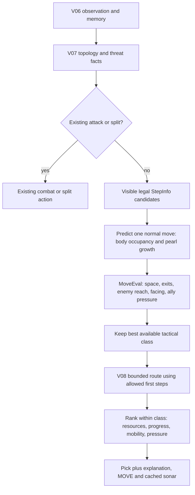

# V09 — Candidate-State Scoring Engine

Current working folder: `UNSW_battlecode/Version09_sketch`.
Frozen previous version: `UNSW_battlecode/Version08_frozen`.
`Version08_sketch` and all earlier version folders remain unchanged.

This implements sections 14–17 of `CODEX_HANDOFF_UNSW_BATTLECODE_V2.md`. V09 changes normal movement policy; it is an experimental sketch, not a demonstrated win-rate upgrade. V10 roles, symmetry, and BugNav are outside this phase.

## Workflow



`candidate.hpp` owns the new `MoveEval`, resulting-state prediction, classification, ranking, and counters. `forage.hpp` owns orchestration and attaches an optional evaluation to `Pick`; `StepInfo` stays compatible. Perception, persistent Memory, V08 navigation, short trades, multi-step dive attacks, and split policy retain their existing responsibilities.

## Mechanics and uncertainty

The rules were checked on 2026-09-23 against the official [movement rules](https://game.battlecode.au/docs/movement), [execution order](https://game.battlecode.au/docs/execution-order), and [death rules](https://game.battlecode.au/docs/death).

Head collisions kill both dragons. Length is relevant to the value of a sacrifice, not collision survival. Dragons execute sequentially; an enemy reach mask represents a possible attack before our next turn, not a simultaneous collision guarantee. Enemy visible length is a lower bound, so a small visible fragment cannot prove an enemy is shorter.

The first move must use a visible empty destination through an EMPTY edge. Current occupied tail cells remain illegal first steps. After a successful non-growing move, a fully reconstructed tail vacates and can contribute to next-turn exits and reachable space. A pearl retains that tail. Incomplete bodies remain conservatively occupied. The new head cannot count itself as an exit on tiny tori.

The evaluator keeps other dragons stationary while predicting local space. Unknown cells and portal edges indicate uncertainty, not known executable exits. It does not forecast enemy sprints, ally movement, new pearls, splitting, or portal destinations. A closed-space classification is a local warning: later body movement may reopen routes.

## Classification and ranking

Classes are ordered, best first:

| Value | Class | Meaning |
|---|---|---|
| 0 | Clear | No known direct enemy-head reach and no predicted closed trap |
| 1 | FavorableExposure | Every reaching enemy has enough visible length for a potentially worthwhile sacrifice by a short dragon with teammates |
| 2 | Exposure | Enemy can reach; favorable sacrifice is not established |
| 3 | Constrained | Closed predicted region is too small for resulting length or is a narrow dead end |
| 4 | NoExit | No known or unknown possible immediate next exit |
| 5 | Illegal | Fails normal first-step legality; never selected |

Only candidates in the best available non-illegal class proceed to routing and ranking. If all legal moves are dangerous, choose the best available class rather than returning no action. FavorableExposure still means possible mutual death, not a win. Existing deliberate short-trade and dive attacks run before this pipeline.

Within that class, ranking uses separate named terms in `MoveEval`: pearl/near-spawn value, objective progress, V08 navigation adjustment, route bonus, capped predicted space, known exits, enemy reach/facing, ally congestion, and deterministic tie breaking. Resource and route bonuses cannot override the class filter. The old hard/soft partition and old tactical sum are replaced only in the V09 branch; they remain intact for ablation.

V07 current-state topology remains in `StepInfo`. Candidate occupancy differs after tail movement, so the local region is recomputed from the decoded snapshot rather than reusing an invalid static region size. At most four searches visit at most 49 visible cells each: **196 candidate nodes per normal decision**. No extra raw vision scan or persistent memory pass is introduced. V07 threat masks are shared; disabling `threat_cache` rebuilds those facts per candidate for comparison. V08 performs at most one route search with the existing 320-node cap.

## Switches and explanations

- Default: `StrategyConfig::candidate_micro = true`.
- Runtime ablation: set `candidate_micro = false`.
- Compile-time ablation: `-DXXQZ_V09=0`; leaves V08 enabled and reproduces V08 full command traces.
- Profiling: `-DXXQZ_ENABLE_STATS=1`. The historical `V05_STATS` protocol marker remains for parser compatibility.
- `head_risk` and `corner_pressure` control the legacy tactical scorer. V09's class filter is controlled by `candidate_micro`; V08 recovery may still consult the legacy tactical scorer.

Selected normal moves append `v09 c=… s=… x=… u=… r=… f=… p=…` to their replay indicator: class, predicted space, known exits, unknown exits, reaching heads, forward-facing reach, and pearl value. Attack/split indicators remain unchanged.

`micro_candidates`, `micro_nodes`, and `micro_filtered` count work. `micro_selected` counts normal V09 decisions. The remaining `micro_*` fields total selected trap warnings, exposed moves, favorable exposures, predicted space, known exits, pearls, and tail releases. Divide selected totals by `micro_selected`, not all dragon turns. They are predicted features, not actual kills or confirmed survival.

## Validation and reproduction

```sh
python3 tests/run.py
python3 tests/run.py --sanitize
python3 tools/benchmark_v09.py --baseline ../Version08_frozen \
  --maps ../maps/arena.map ../maps/default.map ../maps/big_empty.map ../maps/schooltime.map \
  --output /tmp/v09-new-benchmark
python3 tools/audit_v09.py /tmp/v09-new-benchmark
```

C++ tests use strict warnings and both statistics builds. Targeted checks cover growth/tail retention, incomplete bodies, occupied and portal first steps, facing-sensitive threats, pearl-vs-danger filtering, visible lower-bound sacrifice policy, last-dragon protection, all-risk fallback, closed/unknown exits, cache flags, deterministic choices, toroidal geometry, and work bounds. Existing gameplay, perception, cache, navigation, and diagnostic regressions also run. Python checks cover the benchmark parser and read-only observer, including death recording and growth accounting. ASan/UBSan and toolkit project compilation are included.

The benchmark runs V08 self-play, V09 against V08 on both sides, V09-off on both sides, and profile V09 on both sides: 28 runs total. Ablation must match V08 command-for-command; profiling must match the corresponding V09 release trace after removing telemetry. Replay, compressed logs, source hashes, observation metrics and audit examples are archived outside the bot source tree.

Read-only observer measurements include deaths per dragon-turn, cause of death, consecutive cross-team head-collision pairs, and positive surviving length deltas. Trade lengths are latest pre-action observations. Growth deltas undercount pearls when sprinting, splitting, or death hides growth. Comparisons to same-side V08 self-play are descriptive; opponent responses change after strategies diverge. Native-runner success does not prove contest computation-budget compliance. Combat inspection here uses recorded commands, indicators and death events, not graphical replay review.

## Measured results

Results and replay examples are populated from the completed benchmark in `tests/v09-validation.json` and the archive's `candidate-audit.json`.

All 28 runner checks passed. The 8 V09-off games exactly reproduce V08, and all 8 profiling games exactly reproduce V09 release commands. All strict/O2 tests, ASan/UBSan tests, and the toolkit project build passed. Across **85,077 profiled dragon turns**, raw perception remained 49 tiles, routing stayed within one call / 320 nodes, candidate work stayed within 4 evaluations / 196 nodes, and exception/emergency-default counts were zero.

| Map | V09 as A | V09 as B |
|---|---|---|
| arena.map | Loss (round 57) | Loss (round 162) |
| default.map | Win (round 500) | Win (round 500) |
| big_empty.map | Loss (round 500) | Loss (round 500) |
| schooltime.map | Win (round 500) | Win (round 500) |

**4 wins, 4 losses** in this fixed-map comparison. Arena and big_empty remain weaknesses; this phase is not a demonstrated strength improvement.

| Descriptive metric | V08 self-play reference, paired sides | V09 vs V08 |
|---|---:|---:|
| Deaths / 1,000 dragon turns | 16.204 | 15.645 |
| Surviving growth lower bound / 1,000 turns | 81.870 | 75.637 |
| Observed cross-team head-trade pairs | 454 | 490 |
| Mean last-observed enemy length minus own in those trades | 0.000 | 1.218 |

The death rate was about 3.45% lower, while the growth proxy was about 7.61% lower. This suggests an economy tradeoff to investigate before claiming a stronger bot. The self-play trade difference cancels across both sides by construction; these numbers do not establish causal improvements in survival or head-trade quality.

82,327 selected V09 normal moves averaged **24.192 predicted cells** and **2.250 known exits**. 2,250 selections (2.733%) carried a predicted trap warning; 768 were exposed to a reaching head, including 28 classified as potentially favorable sacrifices. 9,765 candidate moves were filtered, and 29,133 selections modeled a vacated tail. These are V09 predictions only; a comparative V08 trap-entry rate and realized post-move space have not been measured.

Recorded examples in `candidate-audit.json`:

- `arena`, V09 A, round 22, dragon 14: `wander E`, class 3, space 3, one exit. The best available class remained constrained; the evaluator still issued a move.
- `arena`, V09 A, round 23, dragon 2: `pearl N`, class 2, one reaching enemy. Exposure is explicitly visible in the replay instead of being hidden in a scalar total.
- `big_empty`, V09 A, round 408, dragon 206: `stalk N`, class 1, one reaching enemy. This is a potential sacrifice, not a claim that the dragon survives a collision.
- The unit threatened-pearl scenario isolates the intended policy change: V08 takes the pearl east; V09 chooses an unexposed direction even with the route bonus. The tail-growth fixture isolates a second change: the same south destination has three future exits without growth, two when the pearl keeps the tail occupied.

Archive: `/Users/fanlingjun/Desktop/UNSW_battlecode/replays/V09-candidate-state-20260923`. It contains full replay files, compressed command logs, immutable benchmark input snapshots, source hashes, observations, candidate audit, test logs, and installation verification. No historical version has been overwritten. V09 remains a sketch pending broader opponents/maps and economy tuning; no V10 roles were added.
