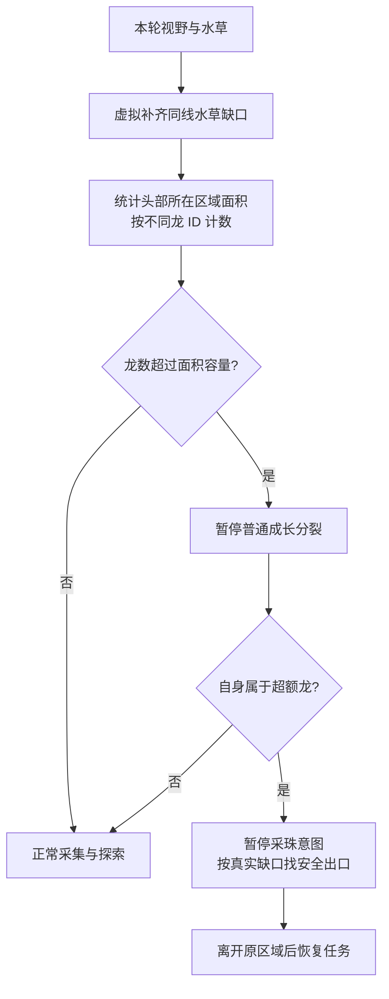

# V5 小空间密度与疏散

## 面积估算

以本轮视野内、自身头部所在的小空间为单位估算面积。先将**同一水平或垂直线上的可见水草段之间的断口虚拟连起来**，再按这组边界与视野边缘做连通区域计算。

这样水草中间有一个或多个空格，也不会让外面的大空间通过缺口混进面积。虚拟连线仅用于面积统计，**真实寻路保留缺口**，不改世界地图或物理碰撞规则。传送门也不把远处的房间合并进本地面积。

面积包括空格、珍珠格和身体占据的格子；身体不是水草墙，不能让同一房间的面积因龙移动而改变。

## 容量和龙数

`capacity = max(1, floor(area / 10))`，即约每 10 格允许一条龙，20 格最多 2 条，40 格最多 4 条。可通过 `V5_DENSITY_CELLS_PER_DRAGON` 调节；`FEAT_REGION_DENSITY=0` 可关掉本机制。

不同龙 ID 算不同龙，同一龙的多个身体格只计一次；友方和敌方都占容量。看到头部时，以头部所在区域判断归属；头部在区域外的龙不因尾巴伸进来重复占本地名额。只有身体、头部不可见时，保守算一条。

超额时保留 ID 较小的友方龙，ID 较大的多余友方龙优先离开。敌方占用的容量也扣掉，不假定敌方会配合疏散。这能避免所有友方同时抢同一个窄出口。

## 决策变化

已验证的撞头攻击、敌方威胁逃跑、必要的喂养或被困救援仍先处理。能安全离开的超额龙进入 `DISPERSE`，优先级高于普通珍珠采集、开局导航和成长分裂。

- 按真实水草和传送门拓扑寻找最短离开路线，不为沿途珍珠增加采集奖励。
- 第一步必须合法，并遵守队友逃生路径、多敌人接触、声纳门口 HOLD 和现有动作最后检查。
- 出口暂时被身体挡住时，优先安全接近出口或找活动空间，不能直接交回珍珠采集。
- 记住离开前的区域，视野随移动变化时继续走出去；到原区域外才结束疏散。连续 8 轮没有进展则重新估算，避免旧区域一直绑住行为。
- 疏散期间取消珍珠意图，不创建新的采珠死胡同任务。
- 房间超额时，允许留下的龙也暂停普通成长分裂，避免刚疏散又增加数量。真正的被困救援仍保留。
- 这里的疏散使用普通移动，不消耗长度做冲刺。遇到敌方紧急威胁仍使用之前的最多消耗 2 段的逃跑冲刺机制。

## 验证

`verification/region_density.cpp.txt` 检查 20 格/2 条、9 格/1 条、无水草 49 格视野、横纵水草缺口、重复身体计数、外部头部与隐藏头部、开局疏散、普通成长抑制、珍珠意图取消、移动后视野改变、真实封闭墙和门口 HOLD。

`verification/region_density_engine.py` 在真实引擎中运行完整 V5，所有友方均使用实际策略，只有远处敌人按脚本移动。4 个场景覆盖：20 格内 3 条从纵向缺口离开、横向缺口离开、20 格内 2 条继续采珠、无水草且未超额时继续采珠。支持 native 和 WASM。

原策略对照：20 格内 3 条的场景先 `MOVE W` 吃珍珠，然后在房间内绕行。启用密度后连续 `MOVE E`，3 次普通移动从缺口离开，长度仍为 2。横向出口有队友阻挡时，会绕一步，然后从实际缺口离开。

补齐边界是局部估计，可能将本来相互无关的同线水草段连在一起；视野之外的面积和龙数不能直接确定。它不会证明房间完全封死，也不会创建穿过真实水草墙的移动。
