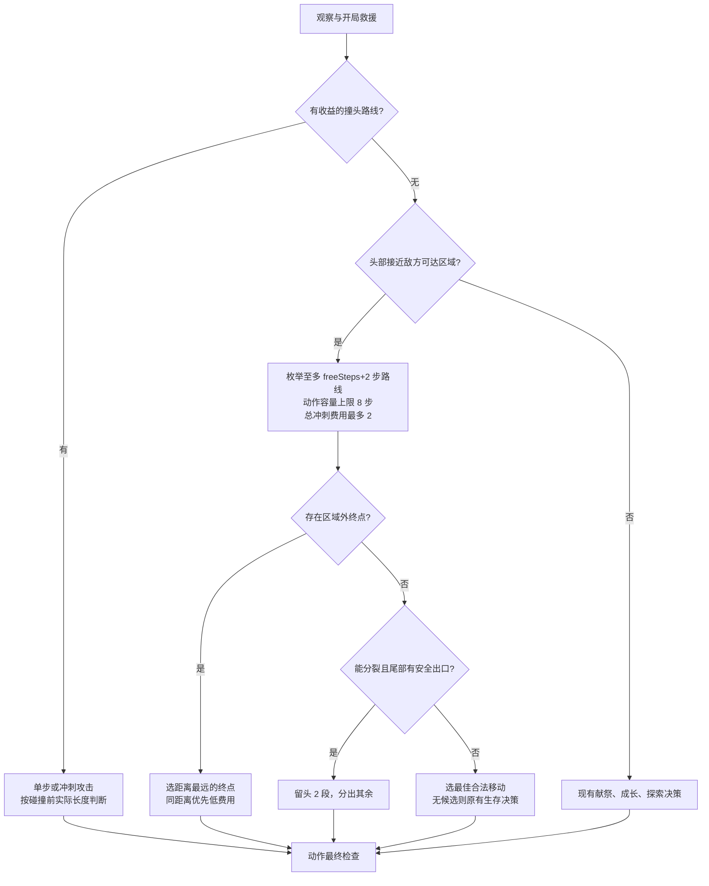

# V5 冲刺攻击与逃跑

决策入口是 `Planner::choose`，物理模拟和可达区域计算在 `sprint.hpp`。

1. 先处理现有开局被困救援，再判断有收益的单步撞头和冲刺撞头。
2. 没有选中攻击且当前头部位于敌方可达区域内时，比较普通移动和冲刺逃跑。
3. 无法通过最多消耗 2 段的移动离开敌方可达区域时，检查紧急分裂：尾部必须已知、位于区域外且有区域外的空出口；普通龙留头部 2 段、分出其余部分；Queen 只分出 2 段，尽量保留本体长度。
4. 无法安全分裂则使用评分最高的合法移动；没有候选时交回原有生存决策。

## 攻击

搜索视野内至多 4 步的路线。每一步检查墙、传送门、身体碰撞、门外 HOLD 和队友通路；撞敌方头部只能作为最后一步。

使用**碰撞时的实际长度**评估撞头：先检查付费能力，碰撞发生时不移动、不吃珍珠、不扣本步长度。原有攻击收益条件、核心大龙保护、多敌人禁用冲刺撞头继续生效。视野里有其他队友、没有其他敌人时，双方碰撞时长度相同且不超过 4、敌方长度确定，也允许冲刺完成撞头。此类撞头是兑子，实际引擎验证双方都会死亡。

## 逃跑

- 免费额度固定为行动开始时 `ceil(length/4)`。搜索最多 `min(8, freeSteps+2)` 步，最多支付 2 段；另设 1,024 个展开状态的计算预算。
- 付费步先检查当前长度至少为 3，再检查完整当前身体的碰撞，移动、吃珍珠，最后扣除 1 段尾部。不能靠该付费步目的地的珍珠补足开始时的支付能力。
- 先选择离开敌人预测可达区域的终点，再优先少支付长度、少走步数；相同步数优先吃珠，然后比较距离和活动空间。不为进一步拉开距离多花长度。终点至少要有一个可以继续走的空位置。
- 敌方可达区域模拟长度支付、已知珍珠及身体；包括普通移动和有长度支付能力的冲刺，以及终止行动的撞击位置。地形距离计入海带墙、地图环绕和已知传送门出口。
- 敌方长度未知时保守给足最多 8 步的搜索预算；走入不可见位置后，未知珍珠可能提供费用，因此保守扩展剩余步数。搜索预算耗尽时扩大到地形可达区域，避免漏搜分支被当作安全。
- 所有长度仍遵守原有多敌人不贴敌方龙、队友通路、门口 HOLD 和动作最后检查。

长度示例（沿途没有珍珠）：长度 2 只能走 1 步；长度 3 最多走 2 步并剩 2；长度 4 最多走 3 步；长度 5–8 的逃跑搜索最多 4 步，长度 9–12 最多 5 步。每组最多支付 2 段。先吃到珍珠可以让长度 2 的龙在同一次行动继续冲刺，但总费用上限仍是 2。

敌方完整身体搜索上限 8 步、256 个状态；仍能继续移动但达到计算预算时，按免费步数、长度与可见珍珠扩展保守地形区域，长度未知时可扩展至地图范围。进入视野外也使用相应剩余预算。

这是基于当前视野和已知拓扑的威胁估算：隐藏敌人和未知传送门落点没有完整位置证据；“距离大于 0”不等于保证下一轮存活。其他龙身体按当前观察作为障碍，后续移动仍需下一轮重算。

## Queen 例外（2026-10-02）

Queen 是固定 ID 0/1，从第 0 回合开始保护。禁止主动单步/冲刺撞头和献祭；第 0–149 回合允许安全发育分裂。Queen 不进入已确认的死胡同，MOVE 和 sprint 每一步都有最终检查；已经在死胡同内时使用普通龙吃珠和尾部分裂脱困规则，可保留头部长度 2。未知地形不能认证为死胡同。Queen 的风险评估覆盖所有敌人长度。详见 `QUEEN_POLICY_20261002.md` 和 `DEADEND_SPRINT_FIX_20261002.md`。

## 当前规则验证

`verification/new_rules_engine.py` 要求官方工具包 >=1.2.3，包含运动模型与引擎的对照、两个 Queen 身份、Queen 长度优先评分及 Queen 死亡后继续比赛。`--wasm` 使用官方编译器和 CPU 计量执行策略场景。

`verification/queen_rules.cpp.txt` 覆盖固定免费额度、碰撞前完整身体、超出八步的敌方威胁、Queen 保护和救援；两个可选旧特性关闭时 Queen 保护仍生效。

## 历史验证记录（旧规则，不代表本次通过）

- `verification/run_checks.py`：15 组 C++ 回归，含长度费用、吃珍珠顺序、撞自身、墙、传送门、未知长度、未知珍珠、同等短龙攻击和紧急分裂。
- `verification/sprint_engine.py` / `--mode wasm`：8 个真实引擎场景，候选龙和分裂子龙使用完整 V5；仅敌人及辅助队友按脚本布置。
- `verification/enemy_contact_engine.py`：13 个旧撞头和多敌人间距场景。
- `verification/portal_hold_engine.py`：8 个旧门口等待和尾部救援场景。
- `verification/protocol_regressions.py --sanitize`：7 个历史输入及内存检查；该旧输入的断言随策略更新；本次优先单步 `MOVE S` 吃到可见珍珠，见专项说明。

## 第 42 回合异常冲刺修复

回放 M845712 / ID 2 原指令为 `MOVE S S S W`，长度 5 的前两步免费、后两步付费，最终长度 3。已知地形重建中旧源码输出同一动作；新源码为 `MOVE N`，保留长度 5。官方引擎从快照新建 bot、没有历史地图时输出单步 `MOVE S`，同样保留长度 5。两项测试分别覆盖带已知地形的策略和真实引擎执行；并非完整比赛胜率验证。
